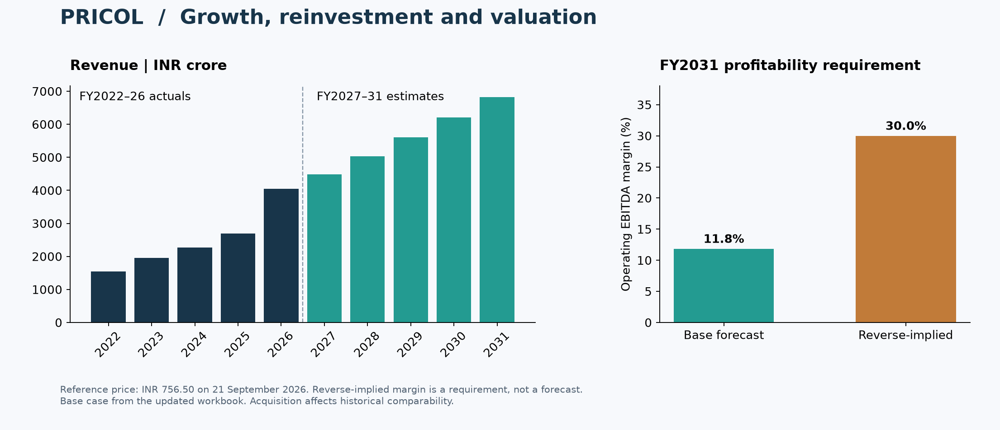

# Pricol Equity Research & Valuation

A consolidated three-statement model with DCF, reverse DCF and a forward P/E comparison. Actuals cover FY2022–FY2026 and estimates cover FY2027–FY2031. Figures are ₹ crore except per-share values and ratios.

**How do growth, reinvestment and operating margins translate into equity value?**

## Results at a glance

| Measure | Saved base case |
| --- | ---: |
| DCF value per share | ₹184.42 |
| Reference price — 21 September 2026 | ₹756.50 |
| FY2031 operating EBITDA margin | 11.8% |
| Reverse-implied FY2031 operating EBITDA margin | 30.0% |
| FY2029 P/E comparison — undiscounted | ₹687.93 |

The P/E comparison is a forward earnings benchmark, distinct from the dated DCF value. Reverse-implied profitability is a conditional requirement, not a forecast. The reference price is not live.

## Explore the research

**[Download the Excel model](https://github.com/keyurmarolia/pricol-equity-research/raw/refs/heads/main/model/Pricol_Equity_Research.xlsx)** · [Methodology](research/Model_Review.md) · [Sources](data/source_register.csv)

Open [the workbook](model/Pricol_Equity_Research.xlsx) at `00_Cover`. `01_Summary` shows earnings and cash-flow trends. Select **1 Base, 2 Upside or 3 Downside** in `02_Assumptions!C3`.

Blue numbers are inputs, green formulas link worksheets and black formulas calculate within a worksheet. Negatives use parentheses. Cells, rows and columns are unmerged and ungrouped.

## Structure

| Worksheets | Purpose |
| --- | --- |
| 00 Cover, 01 Summary | Results and financial trends |
| 02 Assumptions | Operating, accounting and valuation inputs |
| 03 Income Statement, 04 Balance Sheet, 05 Cash Flow | Linked financial statements |
| 06 Schedules | Revenue, working capital, assets, leases and financing |
| 07 FCF, 08 DCF, 09 Reverse DCF | Cash generation and valuation |
| 10 Historical, 11 Sources | Financial history and source documents |

## Forecast drivers

Five groups contain **nine operating inputs per case**:

- Core revenue growth: FY2027 and FY2031 endpoints.
- Plastics growth: FY2027 and FY2028–FY2031 rates.
- Operating EBITDA margin: FY2027 and FY2031 endpoints.
- Net working capital: one ratio to revenue; FY2026 proportions allocate inventory, receivables and payables.
- Capex: a two-year budget and subsequent capex-to-sales ratio.

Base plastics revenue grows 15% in FY2027 after excluding the exited foaming business, then 18% annually. Disclosed turnover capacity caps revenue at ₹1,000 crore in FY2027 and ₹2,000 crore thereafter. Rates and commissioning timing are estimates, not management guidance. Management commentary is separately identified beside assumptions.

Depreciation, tax, leases and financing retain stable supporting inputs. Other assets and liabilities remain at FY2026 balances. No additional acquisition, buyback, demerger uplift or FX/OCI movement is forecast.

## Valuation

Base DCF is **₹184.42/share**, with 12.5% WACC, 4% terminal growth and 12% terminal ROIC. FCFF deducts capex, lease additions, working-capital investment and additional operating cash. Terminal reinvestment equals growth divided by ROIC.

The reference price is ₹756.50 on 21 September 2026, not a live price. Remaining FY2027 cash flow is prorated from that date; FY2026 net claims are a balance-sheet proxy. Holding other drivers fixed, reverse DCF requires approximately **30.0% FY2031 operating EBITDA margin**. This is a conditional requirement, not a forecast.

Applying the Axis September 2026 benchmark of 24x to this model’s FY2029 EPS gives **₹687.93/share, undiscounted**. This forward earnings comparison is distinct from the dated DCF value; the broker’s target is not copied.

## Historical interpretation

FY2026 growth includes a full year of acquired plastics, versus two months in FY2025. Revenue includes other operating revenue, unlike the net-revenue presentation in the broker reports. FY2025 CFO uses the recast FY2026 annual-report comparative. Supplier finance is already included in borrowings.

Historical financial statements and essential accounting schedules support the forecast. Balance-sheet and cash roll-forward checks reconcile the linked statements.

See [methodology and limitations](research/Model_Review.md) and [the source register](data/source_register.csv). Original third-party documents remain local and are not intended for redistribution. This is an educational project, not an investment recommendation.

## Related projects

- [Cholamandalam Finance](https://github.com/keyurmarolia/cholamandalam-finance-equity-research)
- [InterGlobe Aviation](https://github.com/keyurmarolia/interglobe-aviation-equity-research-model)
- [Momentum in Indian equities](https://github.com/keyurmarolia/momentum-in-indian-equities-research)
- [Full research portfolio](https://github.com/keyurmarolia)
